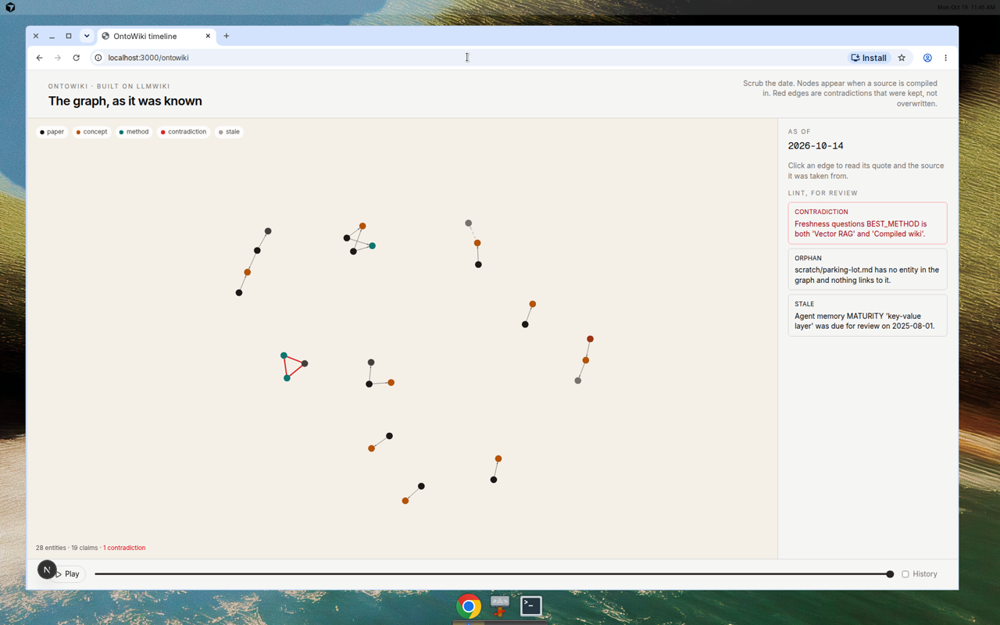
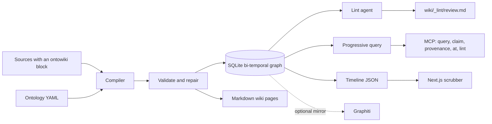
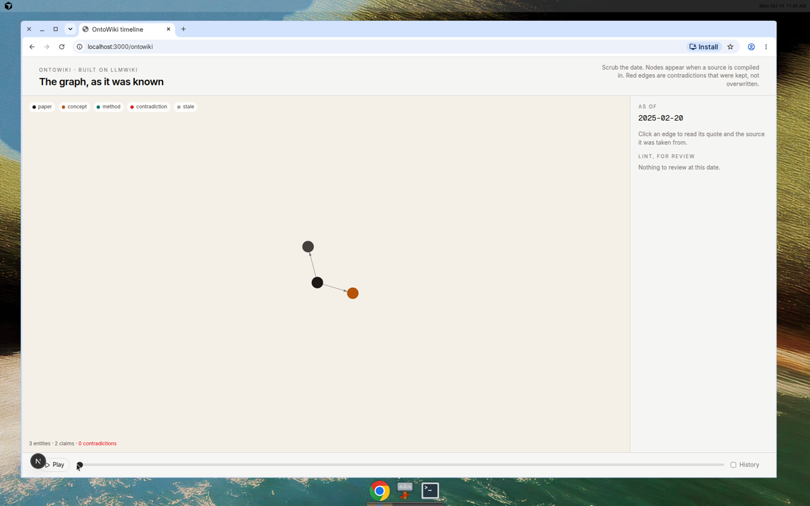
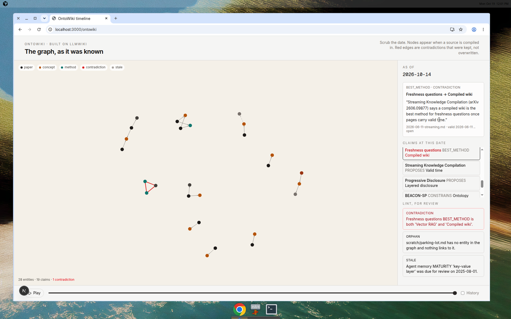

# OntoWiki

**Built on [lucasastorian/llmwiki](https://github.com/lucasastorian/llmwiki).** An ontology-constrained, bi-temporal LLM wiki: sources are compiled once into a typed, dated knowledge graph, and later questions read that graph.

[](LICENSE)

OntoWiki keeps the upstream idea — an LLM maintains a wiki instead of retrieving the raw corpus on every question — and adds the constraints a flat markdown wiki does not carry. Entity and relation types come from a pluggable ontology. Every accepted claim has a grounded quote, a valid-time interval, and a transaction time. A background lint pass writes contradictions, stale claims, and orphan pages into a review file. Other agents reach the same graph through MCP.

The pages below are a compiled reading of public agent-research notes. Scrub the date and the graph is whatever had been ingested by that day. The red edge is a contradiction: two functional claims about the same fact, both still believed at that time.

<p align="center">
  
</p>

## 中文

OntoWiki 基于 [lucasastorian/llmwiki](https://github.com/lucasastorian/llmwiki)。它把来源编译成一份受本体约束、带时间的知识图谱，之后的提问直接读这张图，而不是每次重新检索原文。

沿用上游的核心想法：由模型维护一份 wiki，而不是每次提问都回到原始语料。本仓库补上平铺 markdown 缺少的约束。实体和关系类型来自可插拔的本体；每条被接受的论断都带有可回溯到原文的引文、有效时间，以及写入时间。后台 lint 把矛盾、过期论断和孤儿页面写进审阅文件，不直接改图。其他 agent 通过 MCP 使用同一张图。

下面的页面来自一组公开的 agent 研究笔记。拖动日期，图上只保留那天已经写入的内容。红色边是矛盾：同一条函数性事实，在该时刻同时存在两条仍被相信的论断。

## Why this, why now

[Andrej Karpathy's LLM Wiki gist](https://gist.github.com/karpathy/442a6bf555914893e9891c11519de94f) (4 April 2026) describes three operations on a maintained wiki: ingest, query, and lint. The [note on X](https://x.com/karpathy/status/2040572272944324650) stresses that this kind of memory is explicit and inspectable. [llmwiki](https://github.com/lucasastorian/llmwiki) is an open implementation of that workspace: files in, markdown pages out, MCP on top.

A flat wiki still cannot say which types of entity and relation are allowed, when a belief became true, or which sentence grounds it. Work from 2026 points at that gap:

- [Single-Round Vector RAG vs LLM-Compiled Wiki](https://arxiv.org/abs/2605.18490) compares one-shot retrieval with a compiled wiki.
- [Streaming Knowledge Compilation](https://arxiv.org/abs/2606.09877) treats the wiki as something that changes through time.
- [Progressive Disclosure for an LLM-Maintained Wiki](https://arxiv.org/abs/2607.04576) opens context in layers: index, summary, page, then evidence.
- [Ontology Learning and KG Construction for RAG](https://arxiv.org/abs/2511.05991) and [BEACON-SP](https://arxiv.org/abs/2610.09026) constrain graph extraction with an ontology.
- [Interactive GraphRAG Workspace](https://arxiv.org/abs/2610.23559) asks for an audit trail of why a memory page changed.
- [HippoRAG 2](https://arxiv.org/abs/2502.14802) and [MAST](https://arxiv.org/abs/2503.13657) are earlier points on the same map: associative retrieval, and a taxonomy of multi-agent failure.
- [Graphiti](https://github.com/getzep/graphiti) (Apache-2.0) is a bi-temporal graph built for agent memory. [LightRAG](https://github.com/HKUDS/LightRAG) is the graph-RAG baseline this harness leaves unwired until an LLM index exists.

OntoWiki is the layer that sits on llmwiki and takes those constraints seriously. The corpus in `ontowiki/corpus/` is a set of short original notes that cite those public identifiers. It does not reproduce paper text.

### 为什么是现在

[Karpathy 的 LLM Wiki gist](https://gist.github.com/karpathy/442a6bf555914893e9891c11519de94f)（2026-04-04）把维护一份 wiki 收成三件事：ingest、query、lint。[他在 X 上的说明](https://x.com/karpathy/status/2040572272944324650)强调这种记忆是显式、可检查的。[llmwiki](https://github.com/lucasastorian/llmwiki) 是这个工作区的一个开源实现：文件进去，markdown 页面出来，上面接 MCP。

平铺的 wiki 仍然回答不了：允许哪些实体和关系、一条看法从何时成立、哪一句原文支撑它。2026 年的工作正好指向这个缺口：[向量 RAG 与编译式 wiki 的对比](https://arxiv.org/abs/2605.18490)、[随时间演化的知识编译](https://arxiv.org/abs/2606.09877)、[逐层展开的 wiki 查询](https://arxiv.org/abs/2607.04576)、[面向 RAG 的本体学习](https://arxiv.org/abs/2511.05991)、[本体约束的 GraphRAG](https://arxiv.org/abs/2610.09026)、[可审计的交互式 GraphRAG](https://arxiv.org/abs/2610.23559)。更早的坐标是 [HippoRAG 2](https://arxiv.org/abs/2502.14802) 和 [MAST](https://arxiv.org/abs/2503.13657)。[Graphiti](https://github.com/getzep/graphiti) 提供双时态图；[LightRAG](https://github.com/HKUDS/LightRAG) 是本评测在具备 LLM 索引之前故意留空的图 RAG 基线。

`ontowiki/corpus/` 里是引用这些公开文献的原创短笔记，不是论文正文的复述。

## Architecture



A source is markdown plus a fenced `ontowiki` YAML block: entities, claims, and a quote that must occur in the prose outside the fence. The compiler checks domain, range, literal type, dates, and grounding. Rule repair fixes case, aliases, and dates, and it drops unknown properties. An optional LLM repairer can run one pass and is checked again; the bundled corpus compiles with the rule repairer alone. A quote the prose does not contain is rejected.

The replay clock is the source `published` date, so a rebuild is deterministic. Querying as of `T` returns claims ingested on or before `T` that had not yet been invalidated. Functional relations either supersede the older value or keep both and record a contradiction. Lint recomputes those three findings and writes a review. It does not edit the graph.

The web route `/ontowiki` replays `web/src/data/ontowiki-timeline.json`. An edge is red only when both claims in the contradiction are visible at the scrubbed time. History mode draws invalidated claims in gray.

### 架构

来源是 markdown，外加一段 `ontowiki` YAML：实体、论断，以及必须出现在围栏之外正文中的引文。编译器检查定义域、值域、字面量类型、日期和引文落地。规则修复处理大小写、别名和日期，并丢掉未知属性。可选的 LLM 修复只跑一轮，修完再验证；随仓库附带的语料只用规则修复就能通过。正文里找不到的引文会被拒绝。

回放时钟是来源的 `published` 日期，因此重复编译结果相同。查询“截至 T”时，返回写入时间不晚于 T、且当时尚未失效的论断。函数性关系要么用新值取代旧值，要么两条都保留并记一条矛盾。Lint 重新计算这三类问题并写出审阅，不修改图。

网页路由 `/ontowiki` 回放 `web/src/data/ontowiki-timeline.json`。只有矛盾双方在所选日期都可见时，边才是红色。打开历史后，已失效的论断以灰色显示。

## Demo

Early in the corpus, 20 February 2025, the graph is HippoRAG 2, associative retrieval, and multi-hop QA: 3 entities, 2 claims, 0 contradictions.

<p align="center">
  
</p>

By 14 October 2026 the same scrubber shows 28 entities, 19 claims, and 1 contradiction. Clicking the claim opens the quote, the source file, and the valid interval.

<p align="center">
  
</p>

Below the `lg` breakpoint the scrubber, graph, and claim list stack. The red edge is still the freshness contradiction.

<p align="center">
  
</p>

### 演示

2025-02-20，图上只有 HippoRAG 2、联想检索和多跳问答：3 个实体、2 条论断、0 条矛盾。到 2026-10-14，同一条时间轴上是 28 个实体、19 条论断、1 条矛盾。点开论断可以看到引文、来源文件和有效区间。窄屏下时间轴、图和论断列表纵向排列，红色矛盾边仍然在。

## Quickstart

Python 3.11+ and Node 20+. The timeline page reads a committed JSON file, so the demo does not need a Python server.

```bash
python -m venv .venv && source .venv/bin/activate
pip install -r ontowiki/requirements.txt
python -m ontowiki compile \
  --ontology ontowiki/ontologies/agent-research.yaml \
  --sources ontowiki/corpus/sources \
  --out /tmp/agent-research
python -m ontowiki lint --workspace /tmp/agent-research
python -m ontowiki query \
  "Which paper constrains GraphRAG with an ontology constraint?" \
  --workspace /tmp/agent-research
python -m ontowiki mcp --workspace /tmp/agent-research
```

MCP tools: `wiki_query`, `wiki_claim`, `wiki_provenance`, `wiki_at`, `wiki_lint`. Ingest stays on the CLI so the server keeps one open database.

```bash
cd web && npm install && npm run dev
# http://localhost:3000/ontowiki
```

Regenerate the committed artifacts and fail if they drift:

```bash
python -m ontowiki eval --out ontowiki/eval/results.json --check
python -m ontowiki demo --out web/src/data/ontowiki-timeline.json --check
pytest tests/ontowiki -v
```

Bring your own ontology by copying `ontowiki/ontologies/agent-research.yaml`. Each source needs `published` and a fenced block whose quotes are substrings of the prose.

### 快速开始

需要 Python 3.11+ 和 Node 20+。时间轴页面读取已提交的 JSON，演示本身不需要 Python 服务。上面的命令会编译随仓库附带的笔记、写出 lint 审阅、回答一个本体约束问题，并在 stdio 上提供 MCP。`wiki_query`、`wiki_claim`、`wiki_provenance`、`wiki_at`、`wiki_lint` 是对其他 agent 暴露的工具。摄入只放在 CLI，避免服务进程中途换掉已经打开的数据库。

自带本体可以从 `ontowiki/ontologies/agent-research.yaml` 复制。每个来源需要 `published`，以及一段引文必须是正文子串的围栏块。

## The store

SQLite is the default graph. Each claim stores `valid_from` / `valid_to` (world time) and `ingested_at` / `invalidated_at` (transaction time). Superseded values stay in the table. CI, the tests, and the timeline all run with no extra service and no API key.

[Graphiti](https://github.com/getzep/graphiti) is the optional mirror. It is the right serving index when a deployment already has Neo4j or FalkorDB and an LLM: `add_episode` takes a `reference_time` plus ontology `entity_types` and `edge_types`. It is not the default, because its extractor is an LLM, and because the demo has to stay reproducible offline. Pass `--graphiti` with `GRAPHITI_NEO4J_URI` (and optional `GRAPHITI_NEO4J_USER` / `GRAPHITI_NEO4J_PASSWORD`) after `pip install graphiti-core`. SQLite remains the audit log that lint reads.

### 存储

默认图是 SQLite。每条论断有 `valid_from` / `valid_to`（世界时间）和 `ingested_at` / `invalidated_at`（事务时间）。被取代的值留在表里。CI、测试和时间轴都不需要额外服务或 API key。

[Graphiti](https://github.com/getzep/graphiti) 是可选镜像。部署里已经有 Neo4j 或 FalkorDB 以及一个 LLM 时，它适合作为在线索引：`add_episode` 接受 `reference_time`，以及本体导出的 `entity_types` 和 `edge_types`。它不作为默认后端，因为抽取依赖 LLM，而演示需要离线可复现。安装 `graphiti-core` 并设置 `GRAPHITI_NEO4J_URI` 后，用 `--graphiti` 镜像。Lint 仍然读 SQLite。

## Eval

Numbers below are from `ontowiki/eval/results.json`, produced by `python -m ontowiki eval` on the 8 bundled questions. Tests re-run the harness and compare the file. LightRAG has no score: the harness records `not_run` unless an LLM index is actually built, and this run did not build one.

| System | Answer hit | Source recall | Traceable | Mean context tokens |
| --- | ---: | ---: | ---: | ---: |
| OntoWiki | 1.00 | 1.00 | 1.00 | 77.8 |
| Vector RAG (TF-IDF, k=3) | 0.75 | 1.00 | 0.75 | 147.6 |
| LightRAG | — | — | — | not run |

Answer hit is 1 when the gold string appears in the answer. Source recall is the fraction of gold filenames among the sources the system used. Traceable is 1 when the source that produced the answer is a gold source. Context tokens are `characters / 4` of the returned context.

OntoWiki answers from claims visible at `as_of`, and its context is the progressive-disclosure bundle. Vector RAG indexes source prose with the ontology fence removed, ignores `as_of`, and returns the best-overlapping sentence of the top chunk.

The two vector-RAG misses are real and were left in place:

- `mem0-memory`. The gold answer is "Agent memory" from `2025-04-18-mem0.md`. TF-IDF ranks `2026-06-02-llmwiki-ships.md` first, because that shorter note shares the question's wording more strongly than the Mem0 note. Mem0 is still inside the top 3, so source recall stays 1 and traceable is 0.
- `open-impl-april`. The question is the same text as the October question, with `as_of` 2026-04-04 and gold answer "no open implementation". RAG has no time index and returns the June "open implementation" sentence. OntoWiki, read at 2026-04-04, still has the April literal.

This is a closed set of 8 hand-written questions over 13 notes. It is a regression check for the compiler, not a leaderboard result.

### 评测

上表来自 `ontowiki/eval/results.json`，由 `python -m ontowiki eval` 在 8 道随仓库附带的问题上跑出。测试会重跑并与该文件比对。LightRAG 没有分数：没有真正建好 LLM 索引时，harness 记为 `not_run`，这一次没有建索引。

OntoWiki 只使用 `as_of` 当时可见的论断，上下文是逐层展开的一小段。向量 RAG 对去掉本体围栏后的正文做 TF-IDF，忽略 `as_of`，返回最相关块里重叠最高的句子。

向量 RAG 的两处失手被原样保留。`mem0-memory` 的标准答案在 Mem0 笔记里，TF-IDF 却把更短、用词更接近问句的 llmwiki 笔记排在第一，Mem0 仍在前三，所以来源召回是 1、可追溯是 0。`open-impl-april` 与十月那题文本相同，但 `as_of` 是 2026-04-04，标准答案是 “no open implementation”；RAG 没有时间索引，返回了六月的 “open implementation”。OntoWiki 在 2026-04-04 读到的仍是四月的字面量。

这是 13 篇笔记上的 8 道手写题，用来回归编译器，不是排行榜。

## Tests

`tests/ontowiki` covers ontology repair, supersede and contradiction, grounded compilation, lint findings, time-scoped query, MCP tool registration, the eval artifact, and the timeline artifact. The GitHub Actions job `OntoWiki` runs them on Python 3.11 next to the upstream ruff, unit, MCP, web, and extension jobs.

## The upstream wiki

The rest of this repository is llmwiki: a personal wiki maintained over MCP, with a Next.js reader, a Chrome clipper, and a local SQLite workspace or a hosted Postgres one. Its license is Apache 2.0. See [NOTICE](NOTICE) for the file-level split.

Local upstream setup, unchanged:

```bash
python -m venv .venv && source .venv/bin/activate
pip install -r api/requirements.txt -r mcp/requirements.txt
cd web && npm install && cd ..
./llmwiki open ~/research
./llmwiki mcp-config ~/research
```

`./llmwiki open` indexes a folder, writes `wiki/` and `.llmwiki/`, and serves the reader at [localhost:3000](http://localhost:3000). The landing page links to the OntoWiki timeline. Upstream MCP tools (`guide`, `search`, `read`, `create`, `edit`, `append`, `delete`, `lint`) are a separate server from `python -m ontowiki mcp`.

### 上游 wiki

仓库的其余部分是 llmwiki：通过 MCP 维护的个人 wiki，带 Next.js 阅读器、Chrome 剪藏，以及本地 SQLite 或托管 Postgres。许可证是 Apache 2.0。文件层面的划分见 [NOTICE](NOTICE)。

`./llmwiki open` 会索引一个文件夹，写下 `wiki/` 和 `.llmwiki/`，并在 localhost:3000 提供阅读器。首页有一条进入 OntoWiki 时间轴的链接。上游 MCP 工具和 `python -m ontowiki mcp` 是两套服务器。

## License

Apache 2.0. See [LICENSE](LICENSE) and [NOTICE](NOTICE).

许可证为 Apache 2.0，见 [LICENSE](LICENSE) 与 [NOTICE](NOTICE)。
